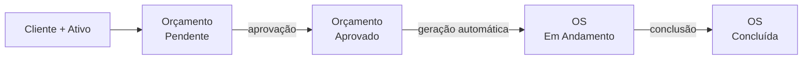

<div align="center">

# 🛠️ Operix

**Gestão inteligente da sua operação**

Sistema desktop em Python para gestão de clientes, ativos, orçamentos e ordens de serviço (OS).

[](https://github.com/breno031-JOW/OPERIX/actions/workflows/ci.yml)


</div>

---

## 📖 Sobre o projeto

O **Operix** é um sistema de gestão interna e de ordens de serviço voltado a pequenos e médios negócios, como oficinas mecânicas, assistências técnicas e prestadores de serviços. Ele reúne em uma interface simples e moderna todo o fluxo operacional: do cadastro do cliente ao orçamento, e da execução da OS até a conclusão.



## 🖼️ Screenshots

| Login | Dashboard |
|:---:|:---:|
|  |  |

| Clientes e Ativos | Orçamentos |
|:---:|:---:|
|  |  |

| Ordens de Serviço |
|:---:|
|  |

## 🚀 Funcionalidades

- 🔒 **Autenticação segura:** login com senhas protegidas por hash (PBKDF2-SHA256 com salt) e suporte a várias empresas (multi-tenant).
- 📊 **Dashboard:** métricas em tempo real (orçamentos pendentes, OS em andamento e total de clientes).
- 👥 **Clientes e ativos:** cadastro unificado de clientes e dos seus ativos (veículos, equipamentos).
- 📝 **Orçamentos:** criação de orçamentos vinculados a cliente e ativo, com validação de valores (aceita `150`, `150,50` ou `1.250,90`).
- 🛠️ **Ordens de serviço:** geração automática da OS ao aprovar o orçamento e acompanhamento até a conclusão.
- 🏢 **Isolamento por empresa:** cada usuário só enxerga e altera os dados da própria empresa.

## 🧰 Tecnologias

| Camada | Tecnologia |
|---|---|
| Linguagem | Python 3.9+ |
| Interface gráfica | Tkinter / ttk (tema customizado) |
| Banco de dados | SQLite3 (sem servidor externo) |
| Paradigma | Orientação a Objetos: classe abstrata (`abc`), herança, polimorfismo e fábrica |
| Testes | pytest |
| CI | GitHub Actions |

> O sistema usa apenas a biblioteca padrão do Python: nenhuma instalação extra é necessária para executar.

## 🗂️ Arquitetura

O projeto segue uma arquitetura em camadas, com a regra de negócio totalmente separada da interface gráfica (por isso é testável sem abrir nenhuma janela):

```
OPERIX/
├── main.py                  # ponto de entrada
├── operix/
│   ├── config.py            # caminho do banco, nome do app, credenciais de demonstração
│   ├── database.py          # conexão SQLite, esquema e carga inicial
│   ├── security.py          # hash e verificação de senhas
│   ├── utils.py             # conversão e formatação de valores monetários
│   ├── models/              # Usuario, Cliente, Ativo (abstrata), Veiculo, Equipamento
│   ├── services/            # regras de negócio (auth, clientes, orçamentos, OS, dashboard)
│   └── ui/                  # Tkinter: tema, componentes e telas
├── tests/                   # testes automatizados (pytest)
└── docs/                    # arquitetura e screenshots
```

Mais detalhes, com diagramas do banco de dados e das classes, em [docs/ARQUITETURA.md](docs/ARQUITETURA.md).

## 🏁 Como executar

### Pré-requisitos

- Python 3.9 ou superior
- Tkinter (já vem com o Python no Windows e no macOS). No Linux, se houver erro de importação:

```bash
sudo apt install python3-tk
```

### Passo a passo

```bash
# 1. Clone o repositório
git clone https://github.com/breno031-JOW/OPERIX.git
cd OPERIX

# 2. (Opcional) Crie e ative um ambiente virtual
python -m venv .venv
source .venv/bin/activate      # Linux/macOS
.venv\Scripts\activate         # Windows

# 3. Execute a aplicação
python main.py                 # ou: python -m operix
```

O banco `operix.db` é criado automaticamente na primeira execução. Para usar outro arquivo, defina a variável de ambiente `OPERIX_DB`.

### 🔑 Acesso de demonstração

| E-mail | Senha |
|---|---|
| `admin@operix.com` | `1234` |

> Conta criada apenas para demonstração, em um banco novo. Em uso real, crie seus próprios usuários.

## 🧪 Testes

```bash
pip install -r requirements-dev.txt
pytest
```

Os testes cobrem hash de senhas, autenticação, cadastro de clientes, o fluxo completo orçamento → OS → conclusão, validações e o isolamento entre empresas.

## 🗺️ Roadmap

- [ ] Baixa automática de estoque ao concluir uma OS
- [ ] Edição e exclusão de clientes, ativos e orçamentos
- [ ] Itens e desconto no orçamento (a coluna `desconto` já existe no banco)
- [ ] Controle de permissões por perfil de usuário
- [ ] Relatórios e exportação em PDF
- [ ] Empacotamento em executável (`.exe`)

## 🤝 Como contribuir

Contribuições são bem-vindas! Veja o guia em [CONTRIBUTING.md](CONTRIBUTING.md).

## 📄 Licença

Distribuído sob a licença MIT. Consulte o arquivo [LICENSE](LICENSE) para mais informações.

## 👤 Autor

Desenvolvido por [@breno031-JOW](https://github.com/breno031-JOW).
