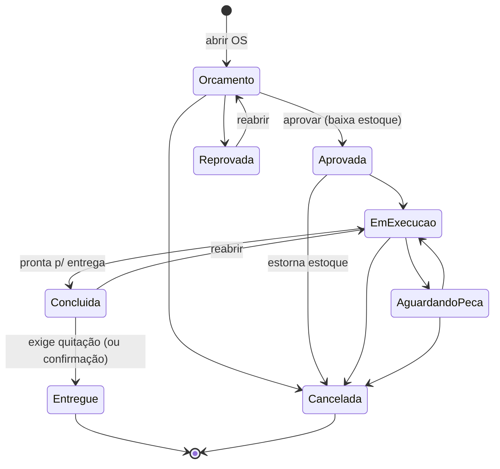

# Arquitetura do Operix 2

## Camadas

```
operix/
├── config.py            caminhos (banco, PDFs, log), tema, parâmetros de segurança
├── errors.py            exceções de negócio com mensagem amigável ao usuário
├── security.py          hash de senhas PBKDF2-SHA256 com salt
├── utils/
│   ├── validators.py    CPF, CNPJ, placa (antiga e Mercosul), telefone, e-mail + máscaras
│   └── formatters.py    moeda (centavos ⇄ "R$ 1.250,90"), quantidades, datas, busca sem acento
├── database/
│   ├── connection.py    Database: conexões curtas, transacionais, sempre fechadas
│   └── migrations.py    esquema versionado (PRAGMA user_version) + conversão do banco antigo
├── models/
│   ├── enums.py         StatusOrdem (máquina de estados), Perfil, Permissao, TipoItem
│   └── entidades.py     dataclasses (OrdemServico calcula totais, saldo etc.)
├── services/            REGRAS DE NEGÓCIO (sem nenhuma dependência de interface)
│   ├── base.py          Sessao + ServicoBase (isolamento por empresa e checagem de permissão)
│   ├── auth.py          login e primeiro acesso
│   ├── usuarios.py      usuários e dados da oficina
│   ├── clientes.py      clientes, veículos e histórico por placa
│   ├── estoque.py       peças, movimentos de estoque e catálogo de mão de obra
│   ├── ordens.py        orçamento → OS → entrega, itens, pagamentos, baixa/estorno de estoque
│   ├── dashboard.py     indicadores operacionais e financeiros
│   └── demo.py          dados de demonstração (python main.py --demo)
├── reports/pdf.py       orçamento, ordem de serviço, recibo e relatório financeiro (fpdf2)
└── ui/                  INTERFACE (Tkinter + ttkbootstrap)
    ├── app.py           janela principal, tratador central de erros, main()
    ├── shell.py         menu lateral filtrado por perfil, atalhos globais, classe View
    ├── widgets.py       TabelaDados, FormularioDialog, ComboBusca, máscaras, toasts
    └── views/           uma tela por arquivo
```

A interface só conversa com `services`. Por isso todas as regras são testadas com
`pytest` sem abrir janelas.

## Fluxo da ordem de serviço



## Perfis de acesso

| Permissão | Administrador | Atendente | Mecânico |
|---|:---:|:---:|:---:|
| Painel operacional | ✔ | ✔ | ✔ (só as próprias OS) |
| Clientes e veículos | ✔ | ✔ | — |
| Abrir OS, lançar peças/mão de obra, desconto | ✔ | ✔ | — |
| Aprovar/reprovar orçamento | ✔ | ✔ | — |
| Status de execução e diagnóstico | ✔ | ✔ | ✔ (OS atribuídas ou sem responsável) |
| Entregar / cancelar OS | ✔ | ✔ | — |
| Registrar pagamento | ✔ | ✔ | — |
| Estornar pagamento | ✔ | — | — |
| Ver estoque | ✔ | ✔ | ✔ |
| Entrada de mercadoria | ✔ | ✔ | — |
| Cadastro/preço de peças e serviços, ajuste de inventário | ✔ | — | — |
| Financeiro, usuários, dados da oficina | ✔ | — | — |

## Integridade dos dados

- Dinheiro em **centavos (INTEGER)**; totais calculados a partir dos itens (sem campos redundantes).
- `UNIQUE (empresa_id, documento)` em clientes, `UNIQUE (empresa_id, placa)` em veículos e
  `UNIQUE (empresa_id, codigo)` em peças.
- `CHECK (estoque >= 0)`: o estoque nunca fica negativo. A aprovação de uma OS sem saldo
  suficiente é recusada e lista as peças que faltam, sem baixar nada (transação).
- Toda movimentação de estoque gera um registro em `movimentos_estoque` (quem, quando, OS, saldo após).
- Toda mudança de status gera um registro em `ordem_historico`.
- Exclusões viram **inativação** (cliente, veículo, peça, usuário), preservando o histórico.

O esquema completo está em [`Operix_Modelo_Fisico.sql`](../Operix_Modelo_Fisico.sql).
